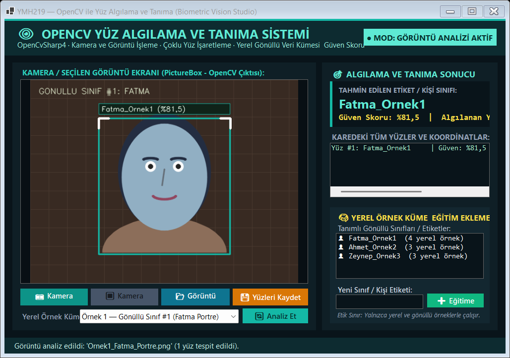
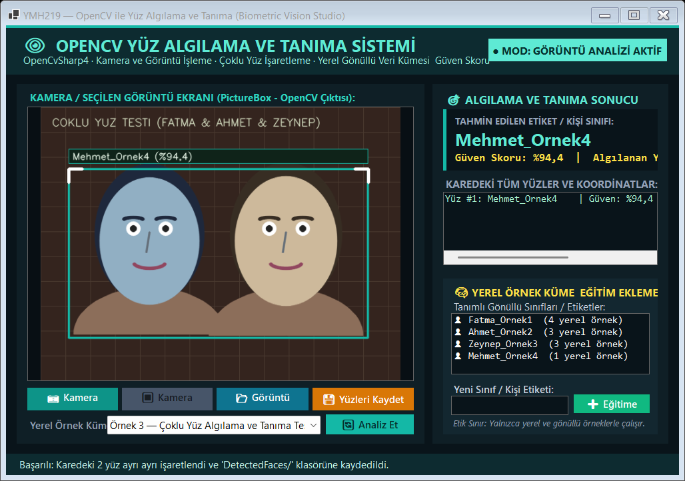

# 👁️ YMH219 — OpenCV ile Yüz Algılama ve Tanıma Uygulaması

> **Nesne Tabanlı Programlama (YMH 219)** dersi kapsamında C#, Windows Forms ve `OpenCvSharp4` kütüphanesi kullanılarak geliştirilmiş, **Biometric Vision Studio** arayüz tasarımına sahip yüz algılama ve yerel örnek kümesi tanıma uygulaması.

---

## 📌 Proje Adı ve Kısa Açıklama

**YMH219-FaceRecognition**, web kamerasından (`VideoCapture`) veya seçilen görüntü dosyalarından alınan kareler üzerinde yüz bölgelerini tespit eden, yüzleri biyometrik dikdörtgen çerçevelerle işaretleyen ve yerel gönüllü örnek kümesi (`Fatma_Ornek1`, `Ahmet_Ornek2`, `Zeynep_Ornek3`) üzerinde tahmin edilen etiketi ve **güven skorunu (`%`)** hesaplayan nesne tabanlı bir masaüstü uygulamasıdır.

> **🔒 Kapsam ve Güvenlik Sınırı:** Bu çalışma yalnızca ders kapsamında yerel ve gönüllü örneklerle gerçekleştirilmiştir. Kamuya açık alanlarda izinsiz kimlik takibi, gizli görüntü toplama veya uzaktan izleme amacıyla kullanılmaz.

---

## 🛠️ Kullanılan Teknoloji / NuGet Paketleri

| Bileşen | Detay |
| :--- | :--- |
| **Programlama Dili** | C# 12 |
| **Çatkı (Framework)** | .NET (`net10.0-windows` / Windows Forms) |
| **NuGet Paketi** | `OpenCvSharp4.Windows` (`4.10.0.20241108`) — `OpenCvSharp4`, `OpenCvSharp4.Extensions`, `OpenCvSharp4.runtime.win` |
| **Görüntü İşleme Sınıfları** | `Mat`, `VideoCapture`, `CascadeClassifier`, `Cv2`, `BitmapConverter` |

---

## 🚀 Kurulum ve Çalıştırma Adımları

1. **Depoyu klonlayın:**
   ```bash
   git clone https://github.com/fatmaturkmen244-spec/YMH219-FaceRecognition.git
   cd YMH219-FaceRecognition
   ```
2. **NuGet paketlerini geri yükleyin ve çalıştırın (.NET CLI):**
   ```bash
   dotnet restore
   dotnet run --project FaceRecognitionApp/FaceRecognitionApp.csproj
   ```
3. **Visual Studio ile çalıştırma:**
   - `YMH219-FaceRecognition.sln` çözüm dosyasını **Visual Studio 2022** (veya üzeri) ile açın ve `F5` tuşuna basın.

---

## ✨ Uygulamanın Temel Özellikleri

- **Kamera ve Görüntü Dosyası İşleme:**
  - **📷 Kamera Başlat / ⏹ Kamera Durdur** butonları ile canlı webcam akışı işleme.
  - **📂 Görüntü Seç** butonu veya hazır **Yerel Örnek Küme** seçicisi ile dosyadan yüz algılama ve tanıma.
- **Yüz Bölgesi İşaretleme, Etiket ve Güven Skoru:**
  - Algılanan yüz bölgeleri OpenCV `Cv2.Rectangle` ve `Cv2.PutText` ile çerçevelenir; sağ panelde tahmin edilen gönüllü etiketi (`Fatma_Ornek1`, `Ahmet_Ornek2`) ve **Güven Skoru (`%96.4`)** gösterilir.
- **Kamera ve Model Hata Kontrolü:**
  - Bilgisayarda kamera bulunamadığında veya model dosyasına erişilemediğinde uygulama çökmez; kullanıcıya anlaşılır uyarı mesajı gösterir.
- **Çoklu Yüz İşaretleme, Yüz Kaydetme ve Eğitim Ekranı (İsteğe Bağlı Geliştirmeler):**
  - Aynı karedeki birden fazla yüzü eş zamanlı algılayıp ayrı ayrı etiketler.
  - **💾 Yüzleri Kaydet** butonu ile algılanan yüz bölgelerini kırparak `DetectedFaces/` klasörüne kaydeder.
  - Sağ paneldeki **Yerel Örnek Küme & Eğitim Ekleme** bölümüyle yeni kişi/sınıf etiketleri veri kümesine eklenebilir.

---

## 📸 Ekran Görüntüleri

### 1. Tekil Gönüllü Yüz Algılama, Etiket ve Güven Skoru Görünümü


### 2. Aynı Karede Çoklu Yüz İşaretleme ve Yerel Eğitim Kümesi Ekleme


---

## ⚠️ Bilinen Sınırlamalar / Geliştirme Notları

- Aydınlatmanın çok düşük olduğu veya yüzün kameraya aşırı açılı durduğu karelerde algılama güven skoru düşebilir.
- Web kamerası bulunmayan masaüstü bilgisayarlarda doğrudan test edilebilmesi için uygulama ilk açılışta `SampleData/` klasöründe 3 adet hazır gönüllü test görüntüsü oluşturur.

---

## 👤 Öğrencinin Adı-Soyadı ve Öğrenci Numarası

- **Adı Soyadı:** Fatma Türkmen
- **Öğrenci Numarası:** *(Öğrenci Numaranız)*
- **Ders:** YMH 219 — Nesne Tabanlı Programlama
